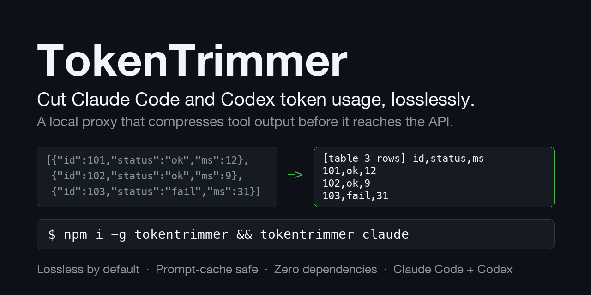

# TokenTrimmer

[](https://www.npmjs.com/package/tokentrimmer) [](LICENSE) 



**Reduce Claude Code token usage and LLM API cost, without losing information.** TokenTrimmer compresses tool
output (JSON, logs, grep results, repeated file contents) in every request before it reaches the Anthropic or
OpenAI API, and keeps prompt caching working.

A local proxy that sits between your app (Claude Code, the Anthropic or OpenAI SDK, any agent) and the API,
and makes each request smaller before it is sent, without changing what the model can read. Zero dependencies,
Node 18+, runs on your machine.

```
your app  ->  TokenTrimmer (127.0.0.1:8787)  ->  api.anthropic.com / api.openai.com
```

## What it does

In an agent session, most of the input tokens are tool output: JSON from APIs, command logs, grep results,
the same file or page fetched twice. The whole conversation is sent again on every turn, so that output is paid
for over and over. TokenTrimmer rewrites tool results into a shorter form as each request passes through:

- **Lossless by default.** JSON is minified, arrays of objects become compact tables, log lines that share a pattern
  store the pattern once, grep output is grouped by directory, and a result or block of lines the model already saw
  earlier becomes a one-line reference to it. Every encoding has a decoder, and a built-in verifier decodes each
  rewritten result before the request is sent. If any check fails, the original request goes out unchanged.
- **Only tool results are touched.** System prompts, tool definitions and the conversation text are sent as is.
  Results from file tools (`Read`, `Edit`, `Write`, …) are left alone too, because edits must match the file
  text exactly.
- **Safe with prompt caching and thinking.** A message's compressed form never changes as the conversation
  grows, so the cached prefix stays byte-identical between requests and Claude's signed thinking blocks stay valid.
- **More savings if you accept some loss (opt-in).** `balanced` and `aggressive` modes drop empty fields,
  collapse repeated log lines and cap huge outputs. Stale mode shrinks old tool results hard, and retrieval lets
  Claude fetch the full text back through a tool when it needs it.
- **You can see what it does.** A local dashboard shows tokens before and after for every request, and dry-run
  mode measures savings without changing anything.

## Results at a glance

TokenTrimmer 0.2.0 against Headroom 0.42.0, on 9 real Claude Code sessions (1,237 requests). Each session is
replayed through both proxies one request at a time, the way Claude Code sends it.

| Proxy, mode | Lossless | Final request | Session cost with prompt caching | Added latency | Slowest request |
|---|---|---:|---:|---:|---:|
| **TokenTrimmer safe (default)** | **yes, every request verified** | **7.2% smaller** | **5.3% cheaper** | **9 ms** | **0.13 s** |
| TokenTrimmer aggressive | no | 14.3% smaller | 11.6% cheaper | 9 ms | 0.05 s |
| TokenTrimmer stale10 | no | 29.8% smaller | 16.4% cheaper | 9 ms | 0.06 s |
| TokenTrimmer stale10 + retrieval | no, Claude can fetch cut text back | 28.8% smaller | 15.3% cheaper | 10 ms | 0.07 s |
| Headroom `token` | no | 5.8% smaller | **11.4% more expensive** | 914 ms | 16.6 s |
| Headroom `--lossless` | yes | 1.6% smaller | 0.9% cheaper | 66 ms | 1.2 s |
| Headroom `cache` (default) | partly | 1.5% smaller | 0.2% cheaper | 104 ms | 6.9 s |

Accuracy: Claude Opus 5.5 was asked to recall exact lines from old tool output in each compressed conversation.

| | Correct | Wrong guesses |
|---|---:|---:|
| Original, uncompressed | 100% | 0 |
| **TokenTrimmer safe** | **100%** (140/140, plus 38/38 where the answer sat behind a reference) | **0** |
| TokenTrimmer stale10 + retrieval | 99% | 1 |
| Headroom default | 95% | 4 |
| TokenTrimmer aggressive | 86% | 1 |
| TokenTrimmer stale10 alone | 35% | 2 |

- **Savings:** TokenTrimmer's lossless default saves more than Headroom's most aggressive mode, with nothing lost.
- **Cost:** this is the column your bill follows. Rewriting earlier turns breaks the prompt cache: Headroom's `token`
  mode makes each request smaller but the session dearer. TokenTrimmer never changes what was already sent.
- **Speed:** about 9 ms per request, against 66–914 ms.
- **Per session:** lossless TokenTrimmer beat Headroom `token` on 5 of the 9 sessions, tied 1, and lost 3 narrowly
  (for example 2.1% against 3.1%). The biggest gaps were browser-heavy sessions (24.9% against 19.2%).

Caveats: the 9 sessions are the author's own, mostly browser automation and assistant work, so your savings will
differ. Run dry-run mode first to see your own number. The accuracy rows other than TokenTrimmer safe were measured
with v0.1.1. Headroom's own retrieval was not tested with a model; its proxies added at most 6 retrieval markers in
these runs. Method and full results: [Real sessions](#real-sessions) and [Proxy against proxy](#proxy-against-proxy).
`compare/` reproduces every number.

## Quick start

```
npm install -g tokentrimmer      # or prefix each command with npx
tokentrimmer claude              # starts the proxy in the background and runs Claude Code through it
```

Everything after `claude` goes to Claude Code unchanged (`tokentrimmer claude --resume`, `tokentrimmer claude -p "…"`).
Open http://127.0.0.1:8787/ to watch the savings. Try `--dry-run` first: requests are measured and the
dashboard shows what you would save, but the original request is forwarded unchanged. Node 18+, no dependencies.

## Commands

| Command | What it does |
|---|---|
| `tokentrimmer` | Run the proxy in the foreground (Ctrl-C to stop) |
| `tokentrimmer claude [args]` | Run Claude Code through the proxy, starting it in the background if it isn't running |
| `tokentrimmer doctor` | Check the proxy, its mode, and how Claude Code is routed (exit code 0 ok, 1 warnings, 2 broken) |
| `tokentrimmer savings` | Lifetime and daily savings, from `~/.tokentrimmer/stats.json`; works without a running proxy |
| `tokentrimmer stop` | Stop a proxy that `tokentrimmer claude` started in the background |
| `tokentrimmer --help` | All options |

Options go before the command: `tokentrimmer --mode balanced claude`, `tokentrimmer --port 9000 --dry-run`.

| Option | Environment variable | Default |
|---|---|---|
| `-p, --port <n>` | `PORT` | 8787 |
| `--host <addr>` | `HOST` | 127.0.0.1 (loopback only; see Security) |
| `-m, --mode <mode>` | `TOKENTRIMMER_MODE` | safe (`safe`, `balanced`, `aggressive`) |
| `--dry-run` | `DRY_RUN=1` | off |
| `--stale-after <n>` | `TOKENTRIMMER_STALE_AFTER` | off (e.g. `10`; ignored in safe mode) |
| | `TOKENTRIMMER_STALE_CHARS` / `_STEP` | 1000 / 20 |
| `--retrieve` | `TOKENTRIMMER_RETRIEVE=1` | off (adds the retrieval tool; Anthropic only) |
| `--exclude-tools <a,b>` | `TOKENTRIMMER_EXCLUDE_TOOLS` | read, read_file, view, edit, multiedit, write, notebookedit, str_replace_editor, skill |
| `--no-verify` | `TOKENTRIMMER_VERIFY=0` | the per-request decode check is on |
| `--no-history` | `TOKENTRIMMER_HISTORY=0` | lifetime counts kept in `~/.tokentrimmer/` (`TOKENTRIMMER_HOME` moves it) |
| `--no-inspect` | `TOKENTRIMMER_INSPECT=0` | the dashboard's before/after view is on (loopback only) |
| | `ANTHROPIC_UPSTREAM` / `OPENAI_UPSTREAM` | https://api.anthropic.com / https://api.openai.com |

Per request: header `x-tokentrimmer-mode: safe|balanced|aggressive` and `x-tokentrimmer-dry-run: 1`. These
headers are not forwarded upstream. `POST /compress` with `{"text": "...", "mode": "balanced"}` returns compressed
text for use outside the proxy, `GET /stats` the dashboard's numbers, `GET /health` the version and mode.

## Use with Claude

### Claude Code in the terminal

Works with both an API key and a Claude subscription login; the proxy forwards your auth headers unchanged.

- **Easiest:** `tokentrimmer claude`. If a proxy is already running in another mode, `tokentrimmer --mode balanced
  claude` uses that mode for this session only (through a request header) instead of restarting it.
- **By hand:** run `tokentrimmer` in one terminal, then `ANTHROPIC_BASE_URL=http://127.0.0.1:8787 claude` in another.
  For one session's mode, add `ANTHROPIC_CUSTOM_HEADERS="x-tokentrimmer-mode: balanced"`.
- **Always:** add the variable to `~/.claude/settings.json`. Claude Code then cannot connect whenever the proxy is
  not running, so remove it if you stop using TokenTrimmer:

  ```json
  { "env": { "ANTHROPIC_BASE_URL": "http://127.0.0.1:8787" } }
  ```

Check that it is working with `tokentrimmer doctor`, or send a message and open http://127.0.0.1:8787/: the
dashboard lists every request with tokens before and after, and **view** shows exactly what was rewritten in it
(original next to what was sent, references highlighted). Start new Claude Code sessions after changing the
mode or upgrading, so the history the API sees stays consistent.

### Anthropic SDK

Set `ANTHROPIC_BASE_URL=http://127.0.0.1:8787` in the environment, or pass it in code:

```python
client = anthropic.Anthropic(base_url="http://127.0.0.1:8787")
```

```js
const client = new Anthropic({ baseURL: 'http://127.0.0.1:8787' });
```

Which mode: the default, `safe`, is lossless. `balanced` and `aggressive` (`tokentrimmer --mode balanced`) drop
content; see the accuracy results below before turning them on for coding work. `tokentrimmer --mode balanced
--stale-after 10 --retrieve` (stale results need a lossy mode) saves the most on long sessions and lets Claude fetch
shortened results back; it is experimental.

## What it compresses

| Technique | Mode | Lossless |
|---|---|---|
| Whitespace, ANSI codes, blank-line runs | safe | yes |
| JSON minify | safe | yes |
| A top-level JSON array of objects becomes a compact text table (`[table N rows] cols`, then one CSV-style row per object); nested objects become dotted columns and the header says `nested` | safe | yes |
| Arrays with a few mixed shapes become one table per shape plus an `[order N]` line that restores the original sequence | safe | yes |
| Log lines sharing a template: templates listed once, each line written as `~N|var|var`, original order kept | safe | yes |
| Tables nested inside a larger JSON object keep a JSON form (`{"_table":{cols,rows}}`) | safe | yes |
| grep-style `path/file:line:text` output: each directory written once as an `@ dir/` header | safe | yes |
| Identical tool results sent again later become `[same as a tool result in message M]` | safe | yes |
| A line or run of lines the model already has verbatim becomes a short reference: `[same as message M lines A-B]` (an earlier tool result, as sent) or `[same as lines A-B above]` (earlier in the same result). Only used when the run is at least 60 characters and twice as long as the reference | safe | yes |
| Drop null / empty JSON fields and all-empty table columns | balanced | no |
| Collapse runs of similar log lines (first and last kept, count shown) | balanced | no |
| Cap huge outputs: head and tail kept, middle omitted and labelled | aggressive | no |
| Opt-in (`TOKENTRIMMER_STALE_AFTER`): tool results older than about N messages are capped hard (`TOKENTRIMMER_STALE_CHARS`). The cutoff moves in steps (`TOKENTRIMMER_STALE_STEP`), so each result changes once and the prompt cache breaks once per step, not every turn. **Experimental:** on its own it cut recall of old details to 35% in the accuracy test below; use it with retrieval | balanced, aggressive | no |
| Opt-in (`TOKENTRIMMER_RETRIEVE=1`, Anthropic `/v1/messages`): a shortened tool result ends with `[tokentrimmer: shortened; full text via tokentrimmer_retrieve {"id":"…"}]`. The proxy adds that tool to every request and answers the model's calls itself, so the client never sees them | any lossy mode | restores content on demand |

Never touched: system prompts, tool definitions, plain-text turns. Only tool results are rewritten, and a
message's rewritten form never changes as the conversation grows (the stale cutoff is the one exception, below).
That keeps the history append-only, which prompt caching and Claude's signed thinking blocks both need.
Tool results are processed, except results from file-content tools (`Read`, `Edit`,
`Write`, `read_file`, `view`, `str_replace_editor`, `skill`, including MCP-prefixed
names such as `mcp__fs__read_file`). Those are never rewritten, because edit tools
match text verbatim, but an identical repeated result is still replaced by a one-line
reference. Override the list with `TOKENTRIMMER_EXCLUDE_TOOLS=name1,name2`. Compression is deterministic, so a repeated
prefix stays identical between requests and provider prompt caching keeps working.

## Security

TokenTrimmer sits between your app and the API, so it sees your API key and every request and response.
What it does with them:

- **Local only by default.** It listens on `127.0.0.1`. The dashboard, `/stats`, `/inspect` and the proxy itself
  have no authentication, so set `--host` to another address only on a network you trust (the before/after view
  then stays off unless you set `TOKENTRIMMER_INSPECT=1`).
- **Forwards only to the configured upstream.** Requests go to `ANTHROPIC_UPSTREAM` / `OPENAI_UPSTREAM`
  (the official APIs by default), with your auth headers passed through unchanged. Pointing an upstream
  somewhere else sends your key there too.
- **No telemetry, no content on disk.** There are no network calls besides the upstream. The command line keeps
  lifetime savings in `~/.tokentrimmer/stats.json` as counts only (requests, token estimates, technique names,
  per day; `--no-history` turns it off), and a proxy started by `tokentrimmer claude` writes its startup lines and
  errors to `~/.tokentrimmer/proxy-<port>.log`. Both files are readable only by you. Used as a library
  (`createServer`), nothing is written.
- **In memory, until restart:** `/stats` keeps the last 50 requests as numbers only (sizes, modes, techniques,
  status). The dashboard's **view** keeps the messages of the last 10 rewritten requests, original and sent, so
  you can see what changed; it is on only when listening on loopback, and `--no-inspect` turns it off. With
  `--retrieve` it also keeps the original text of shortened tool results while answering a request, and the last
  500 retrieval exchanges (conversation content) so replayed turns can be restored.
- **No dependencies.** Only Node built-ins, so there is no third-party code in the request path.
- **The benchmark scripts are separate.** `compare/real/` reads your Claude Code sessions from
  `~/.claude/projects` and writes them to the git-ignored `compare/real/out/`. `eval_accuracy.py` sends session
  content to Claude (`claude -p` or the API), and only when you run it.

## Verification

Every rewritten request is checked before it is sent. The verifier (`src/verify.js`) decodes
each changed string back and compares it with the original:

| Status | Meaning |
|---|---|
| exact | decodes to the identical text |
| whitespace-normalized | identical apart from trailing spaces, blank-line runs and ANSI codes |
| equivalent | identical JSON value (layout and number formatting may differ, for example `1.0` becomes `1`) |
| lossy | a deliberately lossy technique ran (drop empty fields, collapse logs, cap output) |
| FAILED | the decoded text does not match |

In the proxy, a FAILED check means your original request is sent unchanged and the dashboard
shows "FAILED, original sent". Safe mode never reports lossy.

Check any saved request offline:

```
npm run verify -- request.json balanced
```

It prints each changed field with its status and exits non-zero on a failure.

Guards that came out of fuzz testing: JSON containing integers of 16 or more digits (they
would lose precision when re-serialized) or a `__proto__` key is left alone, and grep
grouping is skipped when a leftover line looks like a stripped grep row.
The test suite fuzzes JSON, logs and grep output with random shapes, nasty strings, nested
objects and look-alike lines, and decodes every result.

## Measured results

`npm run bench`, synthetic payloads, token counts estimated:

| Payload | safe | balanced | aggressive |
|---|---|---|---|
| JSON API response, 150 records | 71% | 78% | 78% |
| Server log with retry storm | 62% | 99% | 99% |
| Large source file | 6% | 6% | 82% |
| Whole agent conversation, 5 tool results | 59% | 65% | 89% |

## Compared with Headroom

Same 8 synthetic payloads run through TokenTrimmer and Headroom 0.42.0 (`headroom.compress`,
default settings), one identical counter (about 4 characters per token) over the whole
message list. Reproduce with `compare/export.js` then `compare/run_headroom.py`.

| Payload | TokenTrimmer safe (lossless) | TokenTrimmer balanced | Headroom |
|---|---|---|---|
| JSON API response, 150 records | 74% | 78% | 72% |
| Mixed-shape JSON events | 73% | 74% | 73% |
| grep results, 500 hits | 21% | 21% | 20% |
| Server log, retry storm | 61% | 98% | 10% |
| JavaScript source file | 6% | 6% | 0% |
| Python source with comments | 66% | 66% | 0% |
| Verbose prose | 64% | 64% | 0% |
| Agent conversation, 5 tool results | 59% | 65% | 17% |
| Total | 51% | 57% | 20% |

How to read this:
- Safe mode is the like-for-like column: Headroom's output on JSON, logs and grep kept every
  row. Safe mode is verified lossless by decoder round-trip tests (`src/formats.js`).
- Balanced and aggressive win by omitting content and are not comparable.
- The Python and prose payloads are one template repeated 60 times, which line references collapse. Real files
  rarely repeat like that, so those two rows overstate what to expect.
- The counter is characters divided by four. Real tokenizers may count digits, punctuation and
  CSV-style rows differently, so real savings can be lower or higher. Use dry run: the
  dashboard's "billed input" column is the real figure.
- Headroom was tested with default settings through its library call, not its proxy or its
  more aggressive profiles. The data is synthetic.
- Not tested: whether a model reads TokenTrimmer's table and template formats as accurately as
  the original text. Check that on your own tasks before relying on non-trivial savings.

## Thinking blocks

Current Claude models sign each thinking block over the system prompt, the tool list and every earlier message,
and reject (or, if the request opts in, drop) a block whose history changed. TokenTrimmer is built around that:

- Rewrites are append-only: a message is compressed the same way on every request, so old blocks stay valid.
- Retrieval runs as hidden turns between the proxy and the API. The client gets one assistant turn with a
  labelled `[tokentrimmer_retrieve call … returned:]` block per retrieval. When the client sends that turn back, the
  proxy restores the hidden turns exactly as the API saw them, so the model sees its real call and result and
  every thinking block stays valid. (Without this, in a live test the model saw facts with no source in its
  history, told the user it had guessed them, and retrieved again.) The proxy keeps the last 500 exchanges in
  memory; after a restart the client's copy is sent as is, with the late thinking blocks already left out.
- Moving the stale cutoff does rewrite old messages. On those requests, if the history contains thinking blocks
  and thinking is adaptive, TokenTrimmer sets `thinking.block_binding.prefix_mismatch_behavior: "drop_block"` with the
  `thinking-binding-controls-2026-08-01` beta header, so mismatched blocks are dropped instead of failing the request.
- Starting the proxy, or changing its settings, in the middle of a session also changes the history. Start new
  sessions after changing the setup.

## Real sessions

The synthetic numbers above flatter TokenTrimmer: they are the shapes it was built for. `compare/real/` repeats the
comparison on real Claude Code sessions (9 of the author's own, mostly browser automation and assistant work),
tokens counted with tiktoken o200k_base, Headroom 0.42.0 in library mode. Savings:

| | Final request | Cache-weighted cost, whole session |
|---|---|---|
| TokenTrimmer safe | 6.9% | 5.3% |
| TokenTrimmer aggressive | 13.9% | 11.6% |
| TokenTrimmer balanced + `TOKENTRIMMER_STALE_AFTER=10` | 29.4% | 16.4% |
| TokenTrimmer balanced + stale 10 + `TOKENTRIMMER_RETRIEVE=1` | 28.7% | 15.8% (before retrieval round trips) |
| Headroom library mode, default and coding profiles | 1.2% | 1.3% |
| Headroom library mode, agent-90 profile | 5.6% | not measured |

Most of safe mode's saving on these sessions comes from line references: browser page trees and command output
repeat the same lines within a result and across results, and a 12-token reference replaces each run.

Cache-weighted cost replays each session request by request, priced as prompt caching bills it (0.1x for the prefix
shared with the previous request, 1.25x for the rest). Rewriting old messages re-bills everything after them, which is
why stale mode's saving roughly halves there.

Accuracy: 140 questions over 8 of the sessions, each quoting a line from an old tool result and asking for the line
after it (exact match), answered by Claude Opus 5.5 through `claude -p` with each compressed conversation. Safe mode
was measured on the current version; the other TokenTrimmer rows on v0.1.1, which used fewer, longer references:

| | Correct | Answered UNKNOWN | Wrong guess |
|---|---|---|---|
| original | 100% | 0 | 0 |
| TokenTrimmer safe | 100% | 0 | 0 |
| TokenTrimmer aggressive | 86% | 18 | 1 |
| TokenTrimmer balanced + stale 10 | 35% | 89 | 2 |
| TokenTrimmer balanced + stale 10 + retrieval | 99% | 0 | 1 |
| Headroom default | 95% | 3 | 4 |

Safe mode matched the original. Because few of those 140 answers sit behind a reference, 38 more questions were
added whose answer, in the safe output, is hidden behind a `[same as …]` reference (both kinds); the model answered
38/38, the same as on the original conversation.
Stale mode alone loses most old detail. With retrieval the model read back what it needed and recovered almost
all of it, but every retrieval is an extra round trip that re-reads the context: in this test, where most
questions targeted cut content, stale + retrieval cost about 1.7x as much as sending the original. It pays off
only when old results are rarely needed again; check with dry run and the dashboard's billed input first. Recall of exact lines
is a harsh test: it does not show whether a task still succeeds. The sample is small and from one person's work.

### Proxy against proxy

The table above runs Headroom as a library on whole conversations. Headroom is usually run as a proxy, and its
default proxy mode works differently (it freezes what it has already sent and compresses only the newest part),
so `compare/real/run_proxies.py` also replays the same 9 sessions the way a client sends them: one request per
user message, 1,237 requests in all, each through both proxies running locally (Headroom 0.42.0 `headroom proxy`,
TokenTrimmer `npm start`). A stand-in upstream (`capture_upstream.js`) records exactly what each proxy would
send to the API. Tokens include any retrieval tool a proxy adds.

| Proxy, mode | Final request | Cache-weighted cost | Mean added latency |
|---|---|---|---|
| Headroom, `cache` (default) | 1.5% | 0.2% | 104 ms |
| Headroom, `--lossless` | 1.6% | 0.9% | 66 ms |
| Headroom, `token` | 5.8% | **-11.4%** (costs more than the original) | 914 ms |
| TokenTrimmer, safe (default) | 7.2% | 5.3% | 9 ms |
| TokenTrimmer, aggressive | 14.3% | 11.6% | 9 ms |
| TokenTrimmer, balanced + stale 10 | 29.8% | 16.4% | 9 ms |
| TokenTrimmer, balanced + stale 10 + retrieval | 28.8% | 15.3% | 10 ms |

Safe mode is lossless (every request verified) and still smaller than Headroom's `token` mode, which rewrites
content.

Headroom's `token` mode re-compresses earlier turns as the conversation grows, so the cached prefix keeps
changing and most of each request is billed at the full rate. Headroom's `cache` mode avoids that but compresses
little of these sessions. Latency is the proxy's own time per request on an Apple Silicon laptop, with a
local upstream that answers instantly. The slowest single request took 17 s through Headroom `token` mode and
0.13 s through TokenTrimmer. Where proxies add `cache_control` breakpoints they are ignored in the cost
column, because they mark the cache rather than being part of it.

Not measured here: Headroom's own retrieval (CCR) under a real model. In these runs its proxies added at most
6 retrieval markers in total, so it would change little. The scripts in `compare/` reproduce every number here;
corrections are welcome.

TokenTrimmer is not affiliated with or endorsed by the Headroom project; the name is used only to identify the
software compared.

## Limits

- Savings come from rules, not understanding. Code is not minified, so source files
  only shrink in aggressive mode, by cutting the middle.
- Safe mode is lossless in meaning, not always byte for byte: whitespace cleanup, JSON
  layout and duplicate JSON keys (the last one wins) are not preserved.
- Only a top-level JSON array becomes a text table. An object that wraps an array
  (`{"users":[...]}`) keeps the JSON `_table` form for that array.
- Token counts are estimates. The dashboard also shows the "billed input" the API
  reported, which is the real figure.
- Non-lossless modes can remove information the model needs. Balanced and
  aggressive are labelled in the output so the model knows something was omitted.
- Streaming works (responses are piped through). Only `/v1/messages` and
  `/v1/chat/completions` request bodies are rewritten; other routes pass through.
- Tested against a mock upstream only, not live API traffic.
